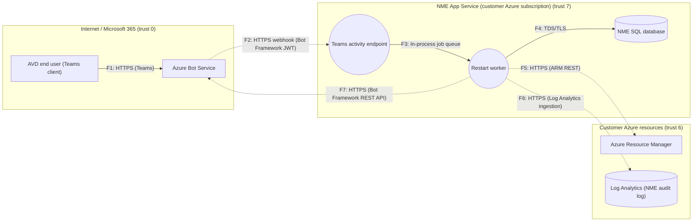

# Threat Model TM-NME-52310: Self-service session host restart from Microsoft Teams

**Product:** NME · **Owner:** Priya Example · **Work item:** https://dev.azure.com/nerdio/NME/_workitems/edit/52310 · **Tier:** 2 (Enhanced) · **Status:** approved

**Design gate:** ✅ PASS — policy ISMS-DEV-004 v1.0

## 1. Triage

Required tier **2** because: architectural_change → tier 1; data_handling_change → tier 1; new_integration → tier 1; authn_authz_change → tier 2; new_external_entry_point → tier 2; privileged_azure_operation → tier 2; data_classification=confidential → tier 1.

## 2. Attack surface

_Dashed arrows cross a trust boundary._

| Entry point | Element | Authentication | Internet-facing |
|---|---|---|---|
| EP1: POST /api/teams/activity | Teams activity endpoint | Bot Framework JWT (issuer + audience = bot app id) | yes |

Trust-boundary crossings: **4** of 7 data flows.

## 3. Threat landscape (inherent risk)

| STRIDE | Critical | High | Medium | Low |
|---|---|---|---|---|
| Spoofing | 0 | 4 | 3 | 0 |
| Tampering | 0 | 2 | 8 | 0 |
| Repudiation | 0 | 2 | 4 | 0 |
| Information disclosure | 0 | 1 | 9 | 0 |
| Denial of service | 0 | 2 | 8 | 0 |
| Elevation of privilege | 0 | 2 | 3 | 0 |

**Residual / untreated:** Critical 0 · High 0 · Medium 11 · Low 37

## 4. Threats

| ID | STRIDE | Target | Threat | Inherent | Status | Mitigations |
|---|---|---|---|---|---|---|
| T-P1-S-001 | S | P1 | Attacker impersonates a legitimate caller of Teams activity endpoint | high (4×4) | mitigated | M-P1-S-001-1 [implemented] https://dev.azure.com/nerdio/NME/_workitems/edit/52409 M-P1-S-001-2 [implemented] https://dev.azure.com/nerdio/NME/_workitems/edit/52410 |
| T-P1-S-002 | S | P1 | Forged inbound event/webhook accepted by Teams activity endpoint | high (4×4) | mitigated | M-P1-S-002-1 [implemented] https://dev.azure.com/nerdio/NME/_workitems/edit/52411 M-P1-S-002-2 [implemented] https://dev.azure.com/nerdio/NME/_workitems/edit/52412 |
| T-P1-S-003 | S | P1 | Service-to-service identity of Teams activity endpoint spoofed or credentials stolen | high (4×4) | mitigation_planned | M-P1-S-003-1 [planned] https://dev.azure.com/nerdio/NME/_workitems/edit/52413 M-P1-S-003-2 [planned] https://dev.azure.com/nerdio/NME/_workitems/edit/52414 |
| T-P1-T-005 | T | P1 | Build or deployment artifact of Teams activity endpoint tampered with | high (4×4) | mitigation_planned | M-P1-T-005-1 [planned] https://dev.azure.com/nerdio/NME/_workitems/edit/52415 M-P1-T-005-2 [planned] https://dev.azure.com/nerdio/NME/_workitems/edit/52416 |
| T-P1-R-001 | R | P1 | Actions performed through Teams activity endpoint cannot be attributed | high (4×4) | mitigation_planned | M-P1-R-001-1 [planned] https://dev.azure.com/nerdio/NME/_workitems/edit/52417 M-P1-R-001-2 [planned] https://dev.azure.com/nerdio/NME/_workitems/edit/52418 |
| T-P1-I-004 | I | P1 | Sensitive data leaked through errors, logs or telemetry of Teams activity endpoint | high (4×4) | mitigation_planned | M-P1-I-004-1 [planned] https://dev.azure.com/nerdio/NME/_workitems/edit/52419 M-P1-I-004-2 [planned] https://dev.azure.com/nerdio/NME/_workitems/edit/52420 |
| T-P1-D-001 | D | P1 | Teams activity endpoint exhausted by request flooding or expensive operations | high (4×4) | mitigation_planned | M-P1-D-001-1 [planned] https://dev.azure.com/nerdio/NME/_workitems/edit/52421 M-P1-D-001-2 [planned] https://dev.azure.com/nerdio/NME/_workitems/edit/52422 |
| T-P1-E-001 | E | P1 | Broken authorization in Teams activity endpoint allows privilege escalation | high (4×4) | mitigation_planned | M-P1-E-001-1 [planned] https://dev.azure.com/nerdio/NME/_workitems/edit/52423 |
| T-P2-FEAT-001 | E | P2 | User restarts a host that is not their own (assignment confusion) | high (3×4) | mitigation_planned | M-P2-FEAT-001-1 [planned] https://dev.azure.com/nerdio/NME/_workitems/edit/52401 |
| T-P1-FEAT-004 | S | P1 | Spoofed bot activity from a different bot or tenant | high (3×4) | mitigated | M-P1-FEAT-004-1 [implemented] https://dev.azure.com/nerdio/NME/_workitems/edit/52404 |
| T-E1-S-004 | S | E1 | Third-party system AVD end user (Teams client) is impersonated or compromised | high (4×3) | rejected | M-E1-S-004-1 [proposed] M-E1-S-004-2 [proposed] |
| T-E1-R-001 | R | E1 | Actions performed through AVD end user (Teams client) cannot be attributed | high (4×3) | rejected | M-E1-R-001-1 [proposed] M-E1-R-001-2 [proposed] |
| T-E2-R-001 | R | E2 | Actions performed through Azure Bot Service cannot be attributed | high (4×3) | mitigation_planned | M-E2-R-001-1 [planned] https://dev.azure.com/nerdio/NME/_workitems/edit/52407 M-E2-R-001-2 [planned] https://dev.azure.com/nerdio/NME/_workitems/edit/52408 |
| T-F1-T-GEN | T | F1 | Tampering with AVD end user (Teams client) → Azure Bot Service (HTTPS (Teams)) | high (4×3) | rejected | M-F1-T-GEN-1 [proposed] |
| T-F1-I-GEN | I | F1 | Information disclosure from AVD end user (Teams client) → Azure Bot Service (HTTPS (Teams)) | high (4×3) | rejected | M-F1-I-GEN-1 [proposed] |
| T-F1-D-GEN | D | F1 | Denial of service against AVD end user (Teams client) → Azure Bot Service (HTTPS (Teams)) | high (4×3) | rejected | M-F1-D-GEN-1 [proposed] |
| T-F2-T-002 | T | F2 | Malicious input injected across trust boundary via Azure Bot Service → Teams activity endpoint (HTTPS webhook (Bot Framework JWT)) | high (4×3) | mitigation_planned | M-F2-T-002-1 [planned] https://dev.azure.com/nerdio/NME/_workitems/edit/52452 M-F2-T-002-2 [planned] https://dev.azure.com/nerdio/NME/_workitems/edit/52453 |
| T-F2-D-004 | D | F2 | Oversized or malformed payloads on Azure Bot Service → Teams activity endpoint (HTTPS webhook (Bot Framework JWT)) crash the receiver | high (4×3) | mitigation_planned | M-F2-D-004-1 [planned] https://dev.azure.com/nerdio/NME/_workitems/edit/52455 |
| T-F3-D-GEN | D | F3 | Denial of service against Teams activity endpoint → Restart worker (In-process job queue) | high (4×3) | rejected | M-F3-D-GEN-1 [proposed] |
| T-P1-FEAT-002 | D | P1 | Restart spam against a user's host (self-inflicted or via compromised Teams account) | medium (3×3) | mitigation_planned | M-P1-FEAT-002-1 [planned] https://dev.azure.com/nerdio/NME/_workitems/edit/52402 |
| T-P2-S-003 | S | P2 | Service-to-service identity of Restart worker spoofed or credentials stolen | medium (3×3) | mitigation_planned | M-P2-S-003-1 [planned] https://dev.azure.com/nerdio/NME/_workitems/edit/52424 M-P2-S-003-2 [planned] https://dev.azure.com/nerdio/NME/_workitems/edit/52425 |
| T-P2-T-005 | T | P2 | Build or deployment artifact of Restart worker tampered with | medium (3×3) | mitigation_planned | M-P2-T-005-1 [planned] https://dev.azure.com/nerdio/NME/_workitems/edit/52426 M-P2-T-005-2 [planned] https://dev.azure.com/nerdio/NME/_workitems/edit/52427 |
| T-P2-R-001 | R | P2 | Actions performed through Restart worker cannot be attributed | medium (3×3) | mitigation_planned | M-P2-R-001-1 [planned] https://dev.azure.com/nerdio/NME/_workitems/edit/52428 M-P2-R-001-2 [planned] https://dev.azure.com/nerdio/NME/_workitems/edit/52429 |
| T-P2-I-004 | I | P2 | Sensitive data leaked through errors, logs or telemetry of Restart worker | medium (3×3) | mitigation_planned | M-P2-I-004-1 [planned] https://dev.azure.com/nerdio/NME/_workitems/edit/52430 M-P2-I-004-2 [planned] https://dev.azure.com/nerdio/NME/_workitems/edit/52431 |
| T-P2-D-GEN | D | P2 | Denial of service against Restart worker | medium (3×3) | mitigation_planned | M-P2-D-GEN-1 [planned] https://dev.azure.com/nerdio/NME/_workitems/edit/52432 |
| T-P2-E-001 | E | P2 | Broken authorization in Restart worker allows privilege escalation | medium (3×3) | mitigation_planned | M-P2-E-001-1 [planned] https://dev.azure.com/nerdio/NME/_workitems/edit/52433 |
| T-P2-E-002 | E | P2 | Over-privileged Azure/Entra identity used by Restart worker | medium (3×3) | mitigation_planned | M-P2-E-002-1 [planned] https://dev.azure.com/nerdio/NME/_workitems/edit/52434 M-P2-E-002-2 [planned] https://dev.azure.com/nerdio/NME/_workitems/edit/52435 |
| T-D1-T-004 | T | D1 | Unauthorized modification of data in NME SQL database | medium (3×3) | mitigation_planned | M-D1-T-004-1 [planned] https://dev.azure.com/nerdio/NME/_workitems/edit/52436 M-D1-T-004-2 [planned] https://dev.azure.com/nerdio/NME/_workitems/edit/52437 |
| T-D1-R-002 | R | D1 | Changes to NME SQL database are not traceable | medium (3×3) | mitigation_planned | M-D1-R-002-1 [planned] https://dev.azure.com/nerdio/NME/_workitems/edit/52438 |
| T-D1-I-003 | I | D1 | Data at rest in NME SQL database exposed | medium (3×3) | mitigation_planned | M-D1-I-003-1 [planned] https://dev.azure.com/nerdio/NME/_workitems/edit/52439 M-D1-I-003-2 [planned] https://dev.azure.com/nerdio/NME/_workitems/edit/52440 |
| T-D1-D-003 | D | D1 | NME SQL database unavailable or data destroyed | medium (3×3) | mitigation_planned | M-D1-D-003-1 [planned] https://dev.azure.com/nerdio/NME/_workitems/edit/52441 |
| T-D2-T-004 | T | D2 | Unauthorized modification of data in Log Analytics (NME audit log) | medium (3×3) | mitigation_planned | M-D2-T-004-1 [planned] https://dev.azure.com/nerdio/NME/_workitems/edit/52446 M-D2-T-004-2 [planned] https://dev.azure.com/nerdio/NME/_workitems/edit/52447 |
| T-D2-R-002 | R | D2 | Changes to Log Analytics (NME audit log) are not traceable | medium (3×3) | mitigation_planned | M-D2-R-002-1 [planned] https://dev.azure.com/nerdio/NME/_workitems/edit/52448 |
| T-D2-I-003 | I | D2 | Data at rest in Log Analytics (NME audit log) exposed | medium (3×3) | mitigation_planned | M-D2-I-003-1 [planned] https://dev.azure.com/nerdio/NME/_workitems/edit/52449 M-D2-I-003-2 [planned] https://dev.azure.com/nerdio/NME/_workitems/edit/52450 |
| T-D2-D-003 | D | D2 | Log Analytics (NME audit log) unavailable or data destroyed | medium (3×3) | mitigation_planned | M-D2-D-003-1 [planned] https://dev.azure.com/nerdio/NME/_workitems/edit/52451 |
| T-E3-S-004 | S | E3 | Third-party system Azure Resource Manager is impersonated or compromised | medium (2×4) | mitigation_planned | M-E3-S-004-1 [planned] https://dev.azure.com/nerdio/NME/_workitems/edit/52442 M-E3-S-004-2 [planned] https://dev.azure.com/nerdio/NME/_workitems/edit/52443 |
| T-E3-R-001 | R | E3 | Actions performed through Azure Resource Manager cannot be attributed | medium (2×4) | mitigation_planned | M-E3-R-001-1 [planned] https://dev.azure.com/nerdio/NME/_workitems/edit/52444 M-E3-R-001-2 [planned] https://dev.azure.com/nerdio/NME/_workitems/edit/52445 |
| T-F5-T-GEN | T | F5 | Tampering with Restart worker → Azure Resource Manager (HTTPS (ARM REST)) | medium (2×4) | mitigation_planned | M-F5-T-GEN-1 [planned] https://dev.azure.com/nerdio/NME/_workitems/edit/52461 |
| T-F5-I-GEN | I | F5 | Information disclosure from Restart worker → Azure Resource Manager (HTTPS (ARM REST)) | medium (2×4) | mitigation_planned | M-F5-I-GEN-1 [planned] https://dev.azure.com/nerdio/NME/_workitems/edit/52462 |
| T-F5-D-GEN | D | F5 | Denial of service against Restart worker → Azure Resource Manager (HTTPS (ARM REST)) | medium (2×4) | mitigation_planned | M-F5-D-GEN-1 [planned] https://dev.azure.com/nerdio/NME/_workitems/edit/52463 |
| T-P2-FEAT-003 | E | P2 | Feature enabled on a host pool without admin intent | medium (2×3) | mitigation_planned | M-P2-FEAT-003-1 [planned] https://dev.azure.com/nerdio/NME/_workitems/edit/52403 |
| T-E2-S-004 | S | E2 | Third-party system Azure Bot Service is impersonated or compromised | medium (2×3) | mitigation_planned | M-E2-S-004-1 [planned] https://dev.azure.com/nerdio/NME/_workitems/edit/52405 M-E2-S-004-2 [planned] https://dev.azure.com/nerdio/NME/_workitems/edit/52406 |
| T-F2-I-GEN | I | F2 | Information disclosure from Azure Bot Service → Teams activity endpoint (HTTPS webhook (Bot Framework JWT)) | medium (2×3) | mitigation_planned | M-F2-I-GEN-1 [planned] https://dev.azure.com/nerdio/NME/_workitems/edit/52454 |
| T-F3-T-GEN | T | F3 | Tampering with Teams activity endpoint → Restart worker (In-process job queue) | medium (2×3) | mitigation_planned | M-F3-T-GEN-1 [planned] https://dev.azure.com/nerdio/NME/_workitems/edit/52456 |
| T-F3-I-GEN | I | F3 | Information disclosure from Teams activity endpoint → Restart worker (In-process job queue) | medium (2×3) | mitigation_planned | M-F3-I-GEN-1 [planned] https://dev.azure.com/nerdio/NME/_workitems/edit/52457 |
| T-F4-T-GEN | T | F4 | Tampering with Restart worker → NME SQL database (TDS/TLS) | medium (2×3) | mitigation_planned | M-F4-T-GEN-1 [planned] https://dev.azure.com/nerdio/NME/_workitems/edit/52458 |
| T-F4-I-GEN | I | F4 | Information disclosure from Restart worker → NME SQL database (TDS/TLS) | medium (2×3) | mitigation_planned | M-F4-I-GEN-1 [planned] https://dev.azure.com/nerdio/NME/_workitems/edit/52459 |
| T-F4-D-GEN | D | F4 | Denial of service against Restart worker → NME SQL database (TDS/TLS) | medium (2×3) | mitigation_planned | M-F4-D-GEN-1 [planned] https://dev.azure.com/nerdio/NME/_workitems/edit/52460 |
| T-F6-T-GEN | T | F6 | Tampering with Restart worker → Log Analytics (NME audit log) (HTTPS (Log Analytics ingestion)) | medium (2×3) | mitigation_planned | M-F6-T-GEN-1 [planned] https://dev.azure.com/nerdio/NME/_workitems/edit/52464 |
| T-F6-I-GEN | I | F6 | Information disclosure from Restart worker → Log Analytics (NME audit log) (HTTPS (Log Analytics ingestion)) | medium (2×3) | mitigation_planned | M-F6-I-GEN-1 [planned] https://dev.azure.com/nerdio/NME/_workitems/edit/52465 |
| T-F6-D-GEN | D | F6 | Denial of service against Restart worker → Log Analytics (NME audit log) (HTTPS (Log Analytics ingestion)) | medium (2×3) | mitigation_planned | M-F6-D-GEN-1 [planned] https://dev.azure.com/nerdio/NME/_workitems/edit/52466 |
| T-F7-T-GEN | T | F7 | Tampering with Restart worker → Azure Bot Service (HTTPS (Bot Framework REST API)) | medium (2×3) | mitigation_planned | M-F7-T-GEN-1 [planned] https://dev.azure.com/nerdio/NME/_workitems/edit/52467 |
| T-F7-I-GEN | I | F7 | Information disclosure from Restart worker → Azure Bot Service (HTTPS (Bot Framework REST API)) | medium (2×3) | mitigation_planned | M-F7-I-GEN-1 [planned] https://dev.azure.com/nerdio/NME/_workitems/edit/52468 |
| T-F7-D-GEN | D | F7 | Denial of service against Restart worker → Azure Bot Service (HTTPS (Bot Framework REST API)) | medium (2×3) | mitigation_planned | M-F7-D-GEN-1 [planned] https://dev.azure.com/nerdio/NME/_workitems/edit/52469 |

## Gate findings

No findings.

_Generated by threatmod on 2026-11-12 — retain as security evidence (3 years)._
