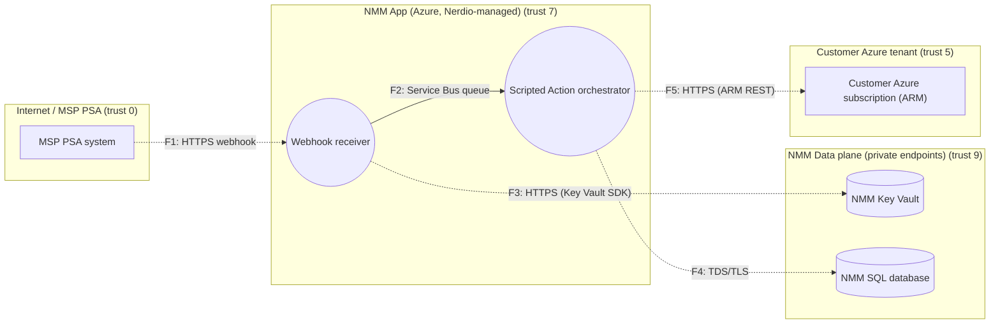

# Threat Model TM-NMM-48211: PSA ticket webhook triggers Scripted Actions

**Product:** NMM · **Owner:** Jordan Example · **Work item:** https://dev.azure.com/nerdio/NMM/_workitems/edit/48211 · **Tier:** 2 (Enhanced) · **Status:** approved

**Design gate:** ✅ PASS — policy ISMS-DEV-004 v1.0

## 1. Triage

Required tier **2** because: architectural_change → tier 1; data_handling_change → tier 1; new_integration → tier 1; new_external_entry_point → tier 2; privileged_azure_operation → tier 2; cross_tenant_data → tier 2; restricted_data → tier 2; data_classification=restricted → tier 2.

## 2. Attack surface

_Dashed arrows cross a trust boundary._

| Entry point | Element | Authentication | Internet-facing |
|---|---|---|---|
| EP1: POST /api/psa/{mspId}/webhook | Webhook receiver | HMAC-SHA256 signature per MSP | yes |
| EP2: Service Bus queue consumer | Scripted Action orchestrator | Managed identity (RBAC on queue) | no |

Trust-boundary crossings: **4** of 5 data flows.

## 3. Threat landscape (inherent risk)

| STRIDE | Critical | High | Medium | Low |
|---|---|---|---|---|
| Spoofing | 0 | 4 | 1 | 0 |
| Tampering | 1 | 6 | 3 | 0 |
| Repudiation | 0 | 4 | 2 | 0 |
| Information disclosure | 5 | 6 | 2 | 0 |
| Denial of service | 0 | 5 | 2 | 0 |
| Elevation of privilege | 3 | 4 | 0 | 0 |

**Residual / untreated:** Critical 0 · High 0 · Medium 22 · Low 25

## 4. Threats

| ID | STRIDE | Target | Threat | Inherent | Status | Mitigations |
|---|---|---|---|---|---|---|
| T-P1-I-002 | I | P1 | Cross-tenant data exposure in Webhook receiver | critical (4×5) | mitigation_planned | M-P1-I-002-1 [planned] https://dev.azure.com/nerdio/NMM/_workitems/edit/48241 M-P1-I-002-2 [planned] https://dev.azure.com/nerdio/NMM/_workitems/edit/48242 |
| T-P1-I-004 | I | P1 | Sensitive data leaked through errors, logs or telemetry of Webhook receiver | critical (4×5) | mitigation_planned | M-P1-I-004-1 [planned] https://dev.azure.com/nerdio/NMM/_workitems/edit/48243 M-P1-I-004-2 [planned] https://dev.azure.com/nerdio/NMM/_workitems/edit/48244 |
| T-P1-E-001 | E | P1 | Broken authorization in Webhook receiver allows privilege escalation | critical (4×5) | mitigation_planned | M-P1-E-001-1 [planned] https://dev.azure.com/nerdio/NMM/_workitems/edit/48248 |
| T-P1-E-002 | E | P1 | Over-privileged Azure/Entra identity used by Webhook receiver | critical (4×5) | mitigation_planned | M-P1-E-002-1 [planned] https://dev.azure.com/nerdio/NMM/_workitems/edit/48249 M-P1-E-002-2 [planned] https://dev.azure.com/nerdio/NMM/_workitems/edit/48250 |
| T-P1-E-004 | E | P1 | MSP/tenant user acts on another tenant via Webhook receiver | critical (4×5) | mitigation_planned | M-P1-E-004-1 [planned] https://dev.azure.com/nerdio/NMM/_workitems/edit/48251 |
| T-F1-I-GEN | I | F1 | Information disclosure from MSP PSA system → Webhook receiver (HTTPS webhook) | critical (4×5) | mitigation_planned | M-F1-I-GEN-1 [planned] https://dev.azure.com/nerdio/NMM/_workitems/edit/48293 |
| T-F3-I-GEN | I | F3 | Information disclosure from Webhook receiver → NMM Key Vault (HTTPS (Key Vault SDK)) | critical (4×5) | mitigation_planned | M-F3-I-GEN-1 [planned] https://dev.azure.com/nerdio/NMM/_workitems/edit/48297 |
| T-F5-I-GEN | I | F5 | Information disclosure from Scripted Action orchestrator → Customer Azure subscription (ARM) (HTTPS (ARM REST)) | critical (4×5) | mitigation_planned | M-F5-I-GEN-1 [planned] https://dev.azure.com/nerdio/NMM/_workitems/edit/48302 |
| T-P2-T-100 | T | P2 | Ticket text used to choose or parameterize the Scripted Action | critical (4×5) | mitigation_planned | M-P2-T-100-1 [planned] https://dev.azure.com/nerdio/NMM/_workitems/edit/48299 M-P2-T-100-2 [planned] https://dev.azure.com/nerdio/NMM/_workitems/edit/48300 |
| T-E1-S-004 | S | E1 | Third-party system MSP PSA system is impersonated or compromised | high (4×4) | mitigation_planned | M-E1-S-004-1 [planned] https://dev.azure.com/nerdio/NMM/_workitems/edit/48231 M-E1-S-004-2 [planned] https://dev.azure.com/nerdio/NMM/_workitems/edit/48232 |
| T-E1-R-001 | R | E1 | Actions performed through MSP PSA system cannot be attributed | high (4×4) | transferred | M-E1-R-001-1 [proposed] M-E1-R-001-2 [proposed] |
| T-P1-S-001 | S | P1 | Attacker impersonates a legitimate caller of Webhook receiver | high (4×4) | rejected | M-P1-S-001-1 [proposed] M-P1-S-001-2 [proposed] |
| T-P1-S-002 | S | P1 | Forged inbound event/webhook accepted by Webhook receiver | high (4×4) | mitigation_planned | M-P1-S-002-1 [planned] https://dev.azure.com/nerdio/NMM/_workitems/edit/48233 M-P1-S-002-2 [planned] https://dev.azure.com/nerdio/NMM/_workitems/edit/48234 |
| T-P1-S-003 | S | P1 | Service-to-service identity of Webhook receiver spoofed or credentials stolen | high (4×4) | mitigation_planned | M-P1-S-003-1 [planned] https://dev.azure.com/nerdio/NMM/_workitems/edit/48235 M-P1-S-003-2 [planned] https://dev.azure.com/nerdio/NMM/_workitems/edit/48236 |
| T-P1-T-005 | T | P1 | Build or deployment artifact of Webhook receiver tampered with | high (4×4) | mitigation_planned | M-P1-T-005-1 [planned] https://dev.azure.com/nerdio/NMM/_workitems/edit/48237 M-P1-T-005-2 [planned] https://dev.azure.com/nerdio/NMM/_workitems/edit/48238 |
| T-P1-R-001 | R | P1 | Actions performed through Webhook receiver cannot be attributed | high (4×4) | mitigation_planned | M-P1-R-001-1 [planned] https://dev.azure.com/nerdio/NMM/_workitems/edit/48239 M-P1-R-001-2 [planned] https://dev.azure.com/nerdio/NMM/_workitems/edit/48240 |
| T-P1-D-001 | D | P1 | Webhook receiver exhausted by request flooding or expensive operations | high (4×4) | mitigation_planned | M-P1-D-001-1 [planned] https://dev.azure.com/nerdio/NMM/_workitems/edit/48245 M-P1-D-001-2 [planned] https://dev.azure.com/nerdio/NMM/_workitems/edit/48246 |
| T-P1-D-002 | D | P1 | Noisy-neighbour tenant degrades Webhook receiver for others | high (4×4) | mitigation_planned | M-P1-D-002-1 [planned] https://dev.azure.com/nerdio/NMM/_workitems/edit/48247 |
| T-F3-T-002 | T | F3 | Malicious input injected across trust boundary via Webhook receiver → NMM Key Vault (HTTPS (Key Vault SDK)) | high (4×4) | rejected | M-F3-T-002-1 [proposed] M-F3-T-002-2 [proposed] |
| T-F3-D-004 | D | F3 | Oversized or malformed payloads on Webhook receiver → NMM Key Vault (HTTPS (Key Vault SDK)) crash the receiver | high (4×4) | rejected | M-F3-D-004-1 [proposed] |
| T-F5-T-GEN | T | F5 | Tampering with Scripted Action orchestrator → Customer Azure subscription (ARM) (HTTPS (ARM REST)) | high (4×4) | mitigation_planned | M-F5-T-GEN-1 [planned] https://dev.azure.com/nerdio/NMM/_workitems/edit/48301 |
| T-F5-D-GEN | D | F5 | Denial of service against Scripted Action orchestrator → Customer Azure subscription (ARM) (HTTPS (ARM REST)) | high (4×4) | mitigation_planned | M-F5-D-GEN-1 [planned] https://dev.azure.com/nerdio/NMM/_workitems/edit/48303 |
| T-P2-I-002 | I | P2 | Cross-tenant data exposure in Scripted Action orchestrator | high (3×5) | mitigation_planned | M-P2-I-002-1 [planned] https://dev.azure.com/nerdio/NMM/_workitems/edit/48261 M-P2-I-002-2 [planned] https://dev.azure.com/nerdio/NMM/_workitems/edit/48262 |
| T-P2-I-004 | I | P2 | Sensitive data leaked through errors, logs or telemetry of Scripted Action orchestrator | high (3×5) | mitigation_planned | M-P2-I-004-1 [planned] https://dev.azure.com/nerdio/NMM/_workitems/edit/48263 M-P2-I-004-2 [planned] https://dev.azure.com/nerdio/NMM/_workitems/edit/48264 |
| T-P2-E-001 | E | P2 | Broken authorization in Scripted Action orchestrator allows privilege escalation | high (3×5) | mitigation_planned | M-P2-E-001-1 [planned] https://dev.azure.com/nerdio/NMM/_workitems/edit/48265 |
| T-P2-E-002 | E | P2 | Over-privileged Azure/Entra identity used by Scripted Action orchestrator | high (3×5) | mitigation_planned | M-P2-E-002-1 [planned] https://dev.azure.com/nerdio/NMM/_workitems/edit/48266 M-P2-E-002-2 [planned] https://dev.azure.com/nerdio/NMM/_workitems/edit/48267 |
| T-P2-E-003 | E | P2 | Script execution in Scripted Action orchestrator escalates to host or tenant control | high (3×5) | mitigation_planned | M-P2-E-003-1 [planned] https://dev.azure.com/nerdio/NMM/_workitems/edit/48268 M-P2-E-003-2 [planned] https://dev.azure.com/nerdio/NMM/_workitems/edit/48269 |
| T-P2-E-004 | E | P2 | MSP/tenant user acts on another tenant via Scripted Action orchestrator | high (3×5) | mitigation_planned | M-P2-E-004-1 [planned] https://dev.azure.com/nerdio/NMM/_workitems/edit/48270 |
| T-D2-I-002 | I | D2 | Cross-tenant data exposure in NMM SQL database | high (3×5) | mitigation_planned | M-D2-I-002-1 [planned] https://dev.azure.com/nerdio/NMM/_workitems/edit/48282 M-D2-I-002-2 [planned] https://dev.azure.com/nerdio/NMM/_workitems/edit/48283 |
| T-D2-I-003 | I | D2 | Data at rest in NMM SQL database exposed | high (3×5) | mitigation_planned | M-D2-I-003-1 [planned] https://dev.azure.com/nerdio/NMM/_workitems/edit/48284 M-D2-I-003-2 [planned] https://dev.azure.com/nerdio/NMM/_workitems/edit/48285 |
| T-P2-T-003 | T | P2 | Script or automation executed by Scripted Action orchestrator is tampered with | high (4×3) | mitigation_planned | M-P2-T-003-1 [planned] https://dev.azure.com/nerdio/NMM/_workitems/edit/48254 M-P2-T-003-2 [planned] https://dev.azure.com/nerdio/NMM/_workitems/edit/48255 M-P2-T-003-3 [planned] https://dev.azure.com/nerdio/NMM/_workitems/edit/48256 |
| T-D1-T-004 | T | D1 | Unauthorized modification of data in NMM Key Vault | high (3×4) | mitigation_planned | M-D1-T-004-1 [planned] https://dev.azure.com/nerdio/NMM/_workitems/edit/48271 M-D1-T-004-2 [planned] https://dev.azure.com/nerdio/NMM/_workitems/edit/48272 |
| T-D1-R-002 | R | D1 | Changes to NMM Key Vault are not traceable | high (3×4) | mitigation_planned | M-D1-R-002-1 [planned] https://dev.azure.com/nerdio/NMM/_workitems/edit/48273 |
| T-D1-I-003 | I | D1 | Data at rest in NMM Key Vault exposed | high (3×4) | mitigation_planned | M-D1-I-003-1 [planned] https://dev.azure.com/nerdio/NMM/_workitems/edit/48274 M-D1-I-003-2 [planned] https://dev.azure.com/nerdio/NMM/_workitems/edit/48275 |
| T-D1-I-005 | I | D1 | Secrets in NMM Key Vault read by over-privileged identities | high (3×4) | mitigation_planned | M-D1-I-005-1 [planned] https://dev.azure.com/nerdio/NMM/_workitems/edit/48276 M-D1-I-005-2 [planned] https://dev.azure.com/nerdio/NMM/_workitems/edit/48277 |
| T-D1-D-003 | D | D1 | NMM Key Vault unavailable or data destroyed | high (3×4) | mitigation_planned | M-D1-D-003-1 [planned] https://dev.azure.com/nerdio/NMM/_workitems/edit/48278 |
| T-E2-S-004 | S | E2 | Third-party system Customer Azure subscription (ARM) is impersonated or compromised | high (3×4) | mitigation_planned | M-E2-S-004-1 [planned] https://dev.azure.com/nerdio/NMM/_workitems/edit/48287 M-E2-S-004-2 [planned] https://dev.azure.com/nerdio/NMM/_workitems/edit/48288 |
| T-E2-R-001 | R | E2 | Actions performed through Customer Azure subscription (ARM) cannot be attributed | high (3×4) | mitigation_planned | M-E2-R-001-1 [planned] https://dev.azure.com/nerdio/NMM/_workitems/edit/48289 M-E2-R-001-2 [planned] https://dev.azure.com/nerdio/NMM/_workitems/edit/48290 |
| T-F1-T-002 | T | F1 | Malicious input injected across trust boundary via MSP PSA system → Webhook receiver (HTTPS webhook) | high (4×3) | mitigation_planned | M-F1-T-002-1 [planned] https://dev.azure.com/nerdio/NMM/_workitems/edit/48291 M-F1-T-002-2 [planned] https://dev.azure.com/nerdio/NMM/_workitems/edit/48292 |
| T-F1-D-004 | D | F1 | Oversized or malformed payloads on MSP PSA system → Webhook receiver (HTTPS webhook) crash the receiver | high (4×3) | mitigation_planned | M-F1-D-004-1 [planned] https://dev.azure.com/nerdio/NMM/_workitems/edit/48294 |
| T-F4-T-002 | T | F4 | Malicious input injected across trust boundary via Scripted Action orchestrator → NMM SQL database (TDS/TLS) | high (4×3) | mitigation_planned | M-F4-T-002-1 [planned] https://dev.azure.com/nerdio/NMM/_workitems/edit/48298 M-F4-T-002-2 [planned] https://dev.azure.com/nerdio/NMM/_workitems/edit/48299 |
| T-F4-D-004 | D | F4 | Oversized or malformed payloads on Scripted Action orchestrator → NMM SQL database (TDS/TLS) crash the receiver | high (4×3) | rejected | M-F4-D-004-1 [proposed] |
| T-F2-I-GEN | I | F2 | Information disclosure from Webhook receiver → Scripted Action orchestrator (Service Bus queue) | medium (2×5) | mitigation_planned | M-F2-I-GEN-1 [planned] https://dev.azure.com/nerdio/NMM/_workitems/edit/48296 |
| T-F4-I-GEN | I | F4 | Information disclosure from Scripted Action orchestrator → NMM SQL database (TDS/TLS) | medium (2×5) | mitigation_planned | M-F4-I-GEN-1 [planned] https://dev.azure.com/nerdio/NMM/_workitems/edit/48300 |
| T-P2-S-003 | S | P2 | Service-to-service identity of Scripted Action orchestrator spoofed or credentials stolen | medium (3×3) | mitigation_planned | M-P2-S-003-1 [planned] https://dev.azure.com/nerdio/NMM/_workitems/edit/48252 M-P2-S-003-2 [planned] https://dev.azure.com/nerdio/NMM/_workitems/edit/48253 |
| T-P2-T-005 | T | P2 | Build or deployment artifact of Scripted Action orchestrator tampered with | medium (3×3) | mitigation_planned | M-P2-T-005-1 [planned] https://dev.azure.com/nerdio/NMM/_workitems/edit/48257 M-P2-T-005-2 [planned] https://dev.azure.com/nerdio/NMM/_workitems/edit/48258 |
| T-P2-R-001 | R | P2 | Actions performed through Scripted Action orchestrator cannot be attributed | medium (3×3) | mitigation_planned | M-P2-R-001-1 [planned] https://dev.azure.com/nerdio/NMM/_workitems/edit/48259 M-P2-R-001-2 [planned] https://dev.azure.com/nerdio/NMM/_workitems/edit/48260 |
| T-P2-D-002 | D | P2 | Noisy-neighbour tenant degrades Scripted Action orchestrator for others | medium (3×3) | accepted | M-P2-D-002-1 [proposed] |
| T-D2-T-004 | T | D2 | Unauthorized modification of data in NMM SQL database | medium (3×3) | mitigation_planned | M-D2-T-004-1 [planned] https://dev.azure.com/nerdio/NMM/_workitems/edit/48279 M-D2-T-004-2 [planned] https://dev.azure.com/nerdio/NMM/_workitems/edit/48280 |
| T-D2-R-002 | R | D2 | Changes to NMM SQL database are not traceable | medium (3×3) | mitigation_planned | M-D2-R-002-1 [planned] https://dev.azure.com/nerdio/NMM/_workitems/edit/48281 |
| T-D2-D-003 | D | D2 | NMM SQL database unavailable or data destroyed | medium (3×3) | mitigation_planned | M-D2-D-003-1 [planned] https://dev.azure.com/nerdio/NMM/_workitems/edit/48286 |
| T-F2-T-GEN | T | F2 | Tampering with Webhook receiver → Scripted Action orchestrator (Service Bus queue) | medium (2×3) | mitigation_planned | M-F2-T-GEN-1 [planned] https://dev.azure.com/nerdio/NMM/_workitems/edit/48295 |

## 5. Risk acceptances

| Threat | Approved by | Risk Register | Review date |
|---|---|---|---|
| T-P2-D-002 | Head of InfoSec (example) (head_of_information_security) | RR-2026-117 | 2027-05-04 |

## Gate findings

No findings.

_Generated by threatmod on 2026-11-05 — retain as security evidence (3 years)._
